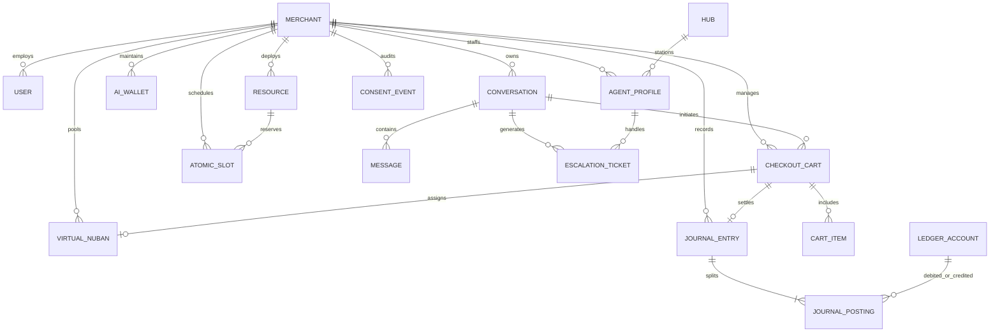

# Database Schema Design Reference & Specification

This document specifies the PostgreSQL relational and transactional database schema for the **Enterprise Conversational Workflow Platform for Nigerian SMEs**.

---

## 1. System Architecture & Topology

The database is structured into **5 Domain-Driven Bounded Contexts** isolated through PostgreSQL logical schemas, running on a single ACID-compliant database instance:

```
PostgreSQL Database: `bsp_whatsapp_enterprise`
├── core            → Tenant infrastructure, merchants, users, global settings
├── ingress         → Webhooks, conversations, fast-path slang dictionary, AI wallets
├── ledger          → Anti-ghosting carts, virtual NUBAN pool, 4-leg double-entry ledger
├── reservations    → Atomic appointment slots, GiST range locks, services, resources
├── desk            → Live agent heartbeat telemetry, NEPA failover, 6-field context tickets
└── compliance      → NDPA 2023 consent ledger (SHA-256 chained), PII redaction audit
```

### Core Design Invariants

1. **Multi-Tenant Row-Level Security (RLS)**:
   - Every domain table includes a mandatory `merchant_id UUID NOT NULL` referencing `core.merchants(id)`.
   - PostgreSQL RLS is enabled on all tables, filtered via `core.current_tenant_id()` mapped to `current_setting('app.current_merchant_id', true)::uuid`.
2. **Deterministic Monetary Representation**:
   - All financial amounts (Naira values, fees, stamp duties, wallet balances) are stored as integer **Kobo (`BIGINT`)** where `₦1.00 = 100 kobo`.
   - Floating-point numbers are strictly prohibited in financial tables to guarantee exact accounting balance ($Assets = Liabilities + Equity$).
3. **Time-Ordered UUIDv7 Identifiers**:
   - All entity primary keys use `UUIDv7` generated via `core.generate_uuid_v7()`.
   - UUIDv7 encodes a Unix millisecond timestamp in the high-order bits, providing sequential B-Tree index locality, preventing index fragmentation during high-throughput webhook ingestion.
4. **PostgreSQL GiST Temporal Range Constraints**:
   - Appointment slot concurrency is enforced via the `btree_gist` extension: `EXCLUDE USING gist (merchant_id WITH =, resource_id WITH =, time_range WITH &&) WHERE (status IN ('HELD_PENDING_PAYMENT', 'CONFIRMED'))`.
5. **Event-Sourced Cryptographic Audit Trails**:
   - NDPA 2023 consent logs are append-only with `SHA-256` hash chaining (`immutable_hash = SHA256(prev_hash + phone + action + timestamp)`), paired with a materialized view for `<1ms` pre-routing status lookups.

---

## 2. Entity-Relationship Diagrams (ERDs)



---

## 3. Detailed Schema Specifications by Bounded Context

### 3.1 `core` Context

#### `core.merchants`
Primary tenant profile and merchant configuration.

| Column | Type | Constraints | Description |
| :--- | :--- | :--- | :--- |
| `id` | `UUID` | `PRIMARY KEY (UUIDv7)` | Unique merchant identifier |
| `business_name` | `VARCHAR(256)` | `NOT NULL` | Registered trade name of the SME |
| `slug` | `VARCHAR(128)` | `UNIQUE NOT NULL` | URL-safe tenant slug |
| `bsp_provider` | `VARCHAR(32)` | `NOT NULL CHECK (META_CLOUD, TERMII, etc.)` | WhatsApp BSP integration rail |
| `whatsapp_business_phone` | `VARCHAR(32)` | `NOT NULL` | Official WhatsApp business phone number |
| `whatsapp_phone_number_id` | `VARCHAR(64)` | | Meta Cloud API Phone Number ID |
| `default_currency` | `CHAR(3)` | `NOT NULL DEFAULT 'NGN'` | ISO-4217 Currency Code |
| `variance_tolerance_kobo`| `BIGINT` | `NOT NULL DEFAULT 0 CHECK (>= 0)` | Discrepancy tolerance threshold in Kobo |
| `anti_ghosting_hold_seconds`| `INTEGER` | `NOT NULL DEFAULT 600` | Hold window countdown (Default 10 mins) |
| `is_active` | `BOOLEAN` | `NOT NULL DEFAULT TRUE` | Active tenant billing flag |
| `created_at` | `TIMESTAMPTZ` | `NOT NULL DEFAULT clock_timestamp()` | Tenant registration timestamp |
| `updated_at` | `TIMESTAMPTZ` | `NOT NULL DEFAULT clock_timestamp()` | Last profile update timestamp |

---

### 3.2 `ingress` Context

#### `ingress.webhook_events`
Asynchronously decoupled webhook receiver logs with `<25ms` acknowledgement audit.

| Column | Type | Constraints | Description |
| :--- | :--- | :--- | :--- |
| `id` | `UUID` | `PRIMARY KEY (UUIDv7)` | Webhook delivery identifier |
| `merchant_id` | `UUID` | `NOT NULL REFERENCES core.merchants(id)` | Receiving tenant ID |
| `provider` | `VARCHAR(32)` | `NOT NULL DEFAULT 'META_CLOUD'` | Source BSP provider |
| `event_type` | `VARCHAR(64)` | `NOT NULL` | `messages.received`, `charge.success`, etc. |
| `external_event_id`| `VARCHAR(128)`| | Provider event ID / WAMID |
| `raw_payload` | `JSONB` | `NOT NULL` | Unmodified incoming JSON payload |
| `signature_verified`| `BOOLEAN` | `NOT NULL DEFAULT FALSE` | SHA256 HMAC verification status |
| `ack_latency_ms` | `INTEGER` | `NOT NULL DEFAULT 0` | Latency to return HTTP 200 OK (<25ms) |
| `worker_status` | `VARCHAR(32)` | `NOT NULL CHECK (QUEUED, PROCESSING, COMPLETED)` | Background processing pipeline status |
| `received_at` | `TIMESTAMPTZ` | `NOT NULL DEFAULT clock_timestamp()` | Delivery timestamp |

#### `ingress.slang_dictionary`
Nigerian Pidgin and Commercial Slang fast-path dictionary indexed with GIN Trigram.

| Column | Type | Constraints | Description |
| :--- | :--- | :--- | :--- |
| `id` | `UUID` | `PRIMARY KEY (UUIDv7)` | Slang entry ID |
| `merchant_id` | `UUID` | `REFERENCES core.merchants(id)` | Nullable for global shared dictionary |
| `phrase_pattern` | `TEXT` | `NOT NULL` | e.g. "How far", "I wan buy", "Alert enter" |
| `standard_english_translation` | `TEXT` | `NOT NULL` | Standard business translation |
| `intent_classification`| `VARCHAR(64)`| `NOT NULL` | `INSTANT_CHECKOUT_ORDER`, `CONFIRM_PAYMENT` |
| `category` | `VARCHAR(32)` | `NOT NULL CHECK (COMMERCE, FINTECH, ...)` | Domain vertical |
| `dialect` | `VARCHAR(32)` | `NOT NULL DEFAULT 'Nigerian Pidgin'` | Detected dialect class |
| `confidence_score` | `NUMERIC(4,2)`| `NOT NULL DEFAULT 0.95` | Fast-path match threshold |

#### `ingress.conversations`
Lead scoring and funnel state machine tracking.

| Column | Type | Constraints | Description |
| :--- | :--- | :--- | :--- |
| `id` | `UUID` | `PRIMARY KEY (UUIDv7)` | Conversation session ID |
| `merchant_id` | `UUID` | `NOT NULL REFERENCES core.merchants(id)` | Tenant ID |
| `customer_phone` | `VARCHAR(32)` | `NOT NULL` | Customer MSISDN (E.164 format) |
| `customer_name` | `VARCHAR(128)` | | Extracted customer name |
| `funnel_stage` | `VARCHAR(32)` | `NOT NULL CHECK (discovery, evaluation, negotiation, checkout)` | Active conversational funnel stage |
| `lead_tier` | `VARCHAR(16)` | `NOT NULL CHECK (HOT, WARM, COLD)` | Game-theoretic lead qualification tier |
| `urgency_score` | `SMALLINT` | `NOT NULL CHECK (BETWEEN 1 AND 10)` | Extracted urgency index |
| `tech_complexity` | `SMALLINT` | `NOT NULL CHECK (BETWEEN 1 AND 10)` | Product / service complexity score |
| `detected_budget_kobo`| `BIGINT` | `NOT NULL DEFAULT 0` | Detected budget constraint in Kobo |
| `detected_dialect`| `VARCHAR(32)` | `NOT NULL DEFAULT 'Standard English'` | Language classification |
| `extracted_entities`| `JSONB` | `NOT NULL DEFAULT '{}'` | Parsed items, delivery locations, timelines |
| `is_open` | `BOOLEAN` | `NOT NULL DEFAULT TRUE` | Active chat session flag |
| `last_message_at` | `TIMESTAMPTZ` | `NOT NULL` | Timestamp of latest interaction |

#### `ingress.ai_wallets` & `ingress.token_ledger_entries`
Naira-denominated prepaid token wallet and per-token consumption audit ledger.

| Table | Key Features |
| :--- | :--- |
| `ai_wallets` | Hard budget cap (`monthly_hard_cap_kobo`), bundled token allocation (`bundled_tokens_remaining`), and non-negative balance constraint (`balance_kobo >= 0`). |
| `token_ledger_entries`| Itemized audit log recording `prompt_tokens`, `completion_tokens`, `cost_kobo`, and `drawdown_type` (`BUNDLED_QUOTA`, `PREPAID_WALLET`, `FAST_PATH_SAVED`). |

---

### 3.3 `ledger` Context

#### `ledger.checkout_carts` & `ledger.cart_items`
Anti-Ghosting shopping cart state engine preserving reservations during out-of-app bank transfers.

| Column | Type | Constraints | Description |
| :--- | :--- | :--- | :--- |
| `id` | `UUID` | `PRIMARY KEY (UUIDv7)` | Cart identifier |
| `merchant_id` | `UUID` | `NOT NULL REFERENCES core.merchants(id)` | Tenant ID |
| `conversation_id` | `UUID` | `REFERENCES ingress.conversations(id)` | Associated WhatsApp chat |
| `customer_phone` | `VARCHAR(32)` | `NOT NULL` | Customer phone number |
| `total_amount_kobo`| `BIGINT` | `NOT NULL CHECK (total_amount_kobo > 0)`| Gross checkout total in Kobo |
| `status` | `VARCHAR(32)` | `NOT NULL CHECK (WAITING_FOR_TRANSFER, PAYMENT_RECEIVED, EXPIRED_RELEASED, ...)` | Cart lifecycle state |
| `hold_expires_at` | `TIMESTAMPTZ` | `NOT NULL` | 10-minute hold expiration boundary |
| `receipt_pushed` | `BOOLEAN` | `NOT NULL DEFAULT FALSE` | Proactive WhatsApp receipt delivery flag |

#### `ledger.virtual_nubans`
Pre-provisioned Dedicated Virtual NUBAN pool with 30-minute cooldown quarantine.

| Column | Type | Constraints | Description |
| :--- | :--- | :--- | :--- |
| `id` | `UUID` | `PRIMARY KEY (UUIDv7)` | Account entry ID |
| `merchant_id` | `UUID` | `NOT NULL REFERENCES core.merchants(id)` | Tenant ID |
| `cart_id` | `UUID` | `REFERENCES ledger.checkout_carts(id)` | Currently assigned cart hold (if active) |
| `bank_name` | `VARCHAR(64)` | `NOT NULL DEFAULT 'Moniepoint MFB'` | Settlement bank institution |
| `bank_code` | `VARCHAR(16)` | `NOT NULL DEFAULT '090405'` | CBN/NIBSS Institution Code |
| `account_number` | `VARCHAR(10)` | `NOT NULL` | 10-digit NUBAN account number |
| `account_name` | `VARCHAR(128)` | `NOT NULL` | Virtual account display name |
| `pool_status` | `VARCHAR(32)` | `NOT NULL CHECK (AVAILABLE, ASSIGNED_HOLD, COOLDOWN_QUARANTINE)` | Account pool lifecycle state |
| `assigned_at` | `TIMESTAMPTZ` | | Timestamp when assigned to cart |
| `hold_expires_at` | `TIMESTAMPTZ` | | Hold expiration timestamp |
| `quarantine_until`| `TIMESTAMPTZ` | | Cooldown release boundary timestamp |

#### `ledger.ledger_accounts`, `ledger.journal_entries`, `ledger.journal_postings`
3-Table Immutable Double-Entry Ledger enforcing the fundamental equation:
$$\sum \text{Debits} = \sum \text{Credits}$$

```
4-Leg Double-Entry Settlement Example (₦45,000 Order):
  DEBIT:  1010 Moniepoint Settlement Clearing Asset    ₦44,275 (₦45,000 - ₦675 - ₦50)
  DEBIT:  5010 Payment Gateway Fee Expense (1.5%)       ₦675
  DEBIT:  5020 Statutory Stamp Duty Expense (Levy)       ₦50
  CREDIT: 4010 WhatsApp Commercial Sales Revenue        ₦45,000
-----------------------------------------------------------------------------
  TOTAL DEBITS: ₦45,000  ==  TOTAL CREDITS: ₦45,000     [BALANCED ✓]
```

A deferred constraint trigger (`ledger.verify_journal_entry_balance()`) validates that debits equal credits before transaction commit.

---

### 3.4 `reservations` Context

#### `reservations.atomic_slots`
Atomic calendar slot booking protected by PostgreSQL GiST exclusion constraints.

```sql
CONSTRAINT atomic_slot_no_overlap EXCLUDE USING gist (
  merchant_id WITH =,
  resource_id WITH =,
  time_range WITH &&
) WHERE (status IN ('HELD_PENDING_PAYMENT', 'CONFIRMED'))
```

| Column | Type | Constraints | Description |
| :--- | :--- | :--- | :--- |
| `id` | `UUID` | `PRIMARY KEY (UUIDv7)` | Slot identifier |
| `merchant_id` | `UUID` | `NOT NULL REFERENCES core.merchants(id)` | Tenant ID |
| `resource_id` | `UUID` | `NOT NULL REFERENCES reservations.resources(id)` | Staff member / asset booked |
| `service_id` | `UUID` | `REFERENCES reservations.services(id)` | Service category |
| `time_range` | `TSTZRANGE` | `NOT NULL` | Start and end timestamp range |
| `price_kobo` | `BIGINT` | `NOT NULL CHECK (price_kobo >= 0)` | Slot price in Kobo |
| `status` | `VARCHAR(32)` | `NOT NULL CHECK (AVAILABLE, HELD_PENDING_PAYMENT, CONFIRMED, RELEASED)` | Booking lifecycle status |
| `held_by_phone` | `VARCHAR(32)` | | Customer phone holding the slot |
| `hold_expires_at`| `TIMESTAMPTZ` | | 10-minute anti-no-show hold boundary |

---

### 3.5 `desk` Context

#### `desk.agent_profiles` & `desk.agent_connectivity_logs`
Real-time heartbeat telemetry tracking NEPA power drops and broadband failover across regional hubs.

- **Heartbeat Architecture**: Agents ping Redis every 30s. If 60s elapse without a ping, Redis triggers a background event marking `status = 'OFFLINE_NEPA'`, rerouting pending chats to backup hubs (`desk.hubs.backup_hub_id`).

#### `desk.escalation_tickets`
Standardized 6-field synthesized context injection cards:

| Field | Column in Table | Description |
| :--- | :--- | :--- |
| 1. Executive Summary | `executive_summary TEXT` | 1-2 sentence synthesized customer intent |
| 2. Detected Budget | `detected_budget_kobo BIGINT` | Extracted deal budget in Kobo |
| 3. Urgency Tier | `urgency_tier VARCHAR(16)` | `HOT`, `WARM`, `COLD` classification |
| 4. Customer Dialect | `dialect VARCHAR(32)` | Pidgin, Slang, or Standard English |
| 5. Key Blockers | `key_blockers TEXT` | Pricing, logistics, or trust friction points |
| 6. Suggested Opening | `suggested_first_response TEXT`| 1-click tailored opening message |

---

### 3.6 `compliance` Context (NDPA 2023)

#### `compliance.consent_events`
Append-only cryptographic consent audit trail with SHA-256 hash chaining:
$$\text{immutable\_hash}_n = \text{SHA256}(\text{immutable\_hash}_{n-1} + \text{phone} + \text{action} + \text{timestamp})$$

#### `compliance.active_consents` (Materialized View)
A high-speed materialized view indexing the current opt-in/opt-out status per phone number to enable sub-millisecond fast-path message filtering.

#### `compliance.redaction_audit_logs`
Audit trail recording PII redactions (`BVN`, `NIN`, `NUBAN`, `CARD_PAN`) sanitized prior to third-party LLM prompting.

---

## 4. Summary of Decisions (ADRs)

| ADR Number | Title | Decision Summary |
| :--- | :--- | :--- |
| [ADR 0016](file:///Users/imac/Artwork/BSP-WhatsApp/docs/adr/0016-postgresql-schemas-rls-uuidv7.md) | PostgreSQL Schemas, RLS, and UUIDv7 | 5 logical schemas on a single DB with PostgreSQL RLS and UUIDv7 PKs. |
| [ADR 0017](file:///Users/imac/Artwork/BSP-WhatsApp/docs/adr/0017-kobo-precision-three-table-ledger.md) | Integer Kobo Precision & 3-Table Ledger | Minor currency `BIGINT` Kobo with immutable accounts, entries, and postings. |
| [ADR 0018](file:///Users/imac/Artwork/BSP-WhatsApp/docs/adr/0018-virtual-nuban-pool-quarantine.md) | Pre-Provisioned Virtual NUBAN Pool | Local account pool with 30-min cooldown quarantine to prevent NIP transfer race conditions. |
| [ADR 0019](file:///Users/imac/Artwork/BSP-WhatsApp/docs/adr/0019-partial-gist-active-slots.md) | Partial GiST Temporal Exclusion | GiST `TSTZRANGE` lock restricted to active holds and confirmed bookings. |
| [ADR 0020](file:///Users/imac/Artwork/BSP-WhatsApp/docs/adr/0020-sha256-chained-consent-ledger.md) | SHA-256 Chained Consent Ledger | Event-sourced append-only consent audit trail paired with materialized view. |
| [ADR 0021](file:///Users/imac/Artwork/BSP-WhatsApp/docs/adr/0021-check-constraints-over-native-enums.md) | Check Constraints over Native Enums | `VARCHAR(32)` + `CHECK` constraints for zero-downtime database migrations. |
| [ADR 0022](file:///Users/imac/Artwork/BSP-WhatsApp/docs/adr/0022-gin-trigram-indexing-nigerian-slang.md) | GIN Trigram Indexing for Slang | `pg_trgm` GIN indexes for localized fuzzy matching in PostgreSQL. |
